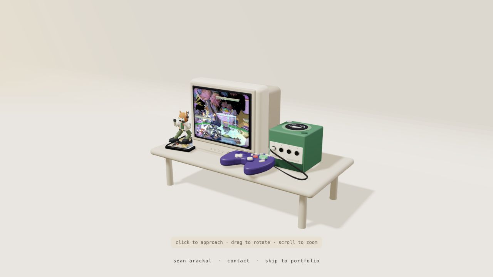

# Sean Arackal: interactive portfolio

A personal portfolio built around a 3D GameCube and CRT. Enter the screen to explore a desktop with project files, a browser, and a messaging app.

**[Explore the interactive site](https://scriblesean.github.io/)** · **[Read the portfolio](https://scriblesean.github.io/portfolio/)** · **[Download my resume](https://scriblesean.github.io/resume/sean-arackal-resume.pdf)**

[](https://scriblesean.github.io/)

*Screenshot of the running site, September 2026.*

## What to try

- Enter the CRT and open the desktop apps. Windows can move, resize, minimize, and maximize.
- Open Files to browse project contributions and download the resume.
- Open the portfolio in the desktop browser, or use the direct portfolio link above.
- Open Messages to write a conversation and send it to me.

The desktop browser shows the portfolio. Other websites and searches open in a new tab.

## How it is built

Next.js and React handle the routes and desktop interface. Three.js, React Three Fiber, and Drei render the scene. GitHub Actions builds a static export for GitHub Pages, so hosting needs no application server.

Project pages read `data/featured-projects.json`. Past projects, work history, and the Files app read `data/resume.json`. Resume downloads and previews use the PDF in `public/resume/`. Messages posts to a configurable external form endpoint. It is not a live chat service.

## Run locally

Requires Node.js 22 or newer (CI builds on Node 24).

```bash
npm ci
npm run dev
```

Open `http://localhost:3000`. For a static production preview:

```bash
npm run build
python3 -m http.server 3000 --directory out
```

## Verify changes

```bash
npm run lint
npm run typecheck
npm test
npm run build
```

After interface changes, check both the direct portfolio and the embedded desktop. The automated tests cover desktop windows and message handling. They do not check that email arrives or how the 3D scene looks.

## Project map

| Location | Responsibility |
| --- | --- |
| `components/scene/` | 3D setup and camera interaction |
| `components/desktop/` | Desktop shell and app windows |
| `components/browser/`, `files/`, `messages/` | Desktop applications |
| `components/portfolio/` | Direct and embedded portfolio |
| `data/featured-projects.json` | Current project pages |
| `data/resume.json` | Past projects and work history |
| `public/resume/` | Resume PDF and its PNG preview |

See [deployment and asset notes](DEPLOYMENT.md) for hosting, contact configuration, source references, and resume updates.
